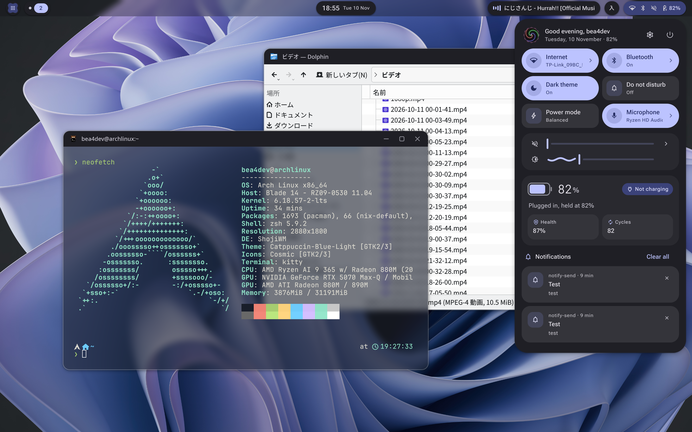

# shoji-bar-4

A Material 3 Expressive desktop shell for [ShojiWM](https://github.com/bea4dev/ShojiWM), written in Rust on [AntiWebUI](https://github.com/bea4dev/AntiWebUI).



- **Top bar** of floating islands: launcher, workspaces, the active window, a rolling clock, now playing, tray and status icons.
- **Dock** that hides at the bottom edge and rises when the pointer reaches it.
- **Quick settings**, **calendar**, **launcher**, **clipboard history**, **media player**, **notifications**, **OSD** and a **lock screen**.
- **Dynamic color** from a seed or the wallpaper, moved to on a spring everywhere at once, window frames included.
- Springs and shape morphs throughout, and no frames drawn while nothing moves (0% CPU when idle).

## Getting started

You need ShojiWM, a Rust toolchain, and the usual desktop services: NetworkManager, BlueZ, PipeWire, UPower, power-profiles-daemon and logind. `cliphist` and `wl-clipboard` give the clipboard history, and `zenity` lets you pick a user picture.

```sh
git clone https://github.com/bea4dev/shoji-bar-4 ~/.config/shoji-bar-4
cd ~/.config/shoji-bar-4
cargo build --release
```

ShojiWM's default config starts `~/.config/shoji-bar-4/target/release/shoji-bar-4` with the session, binds its keys (`Super` for the launcher, `Super+N` quick settings, `Super+C` calendar, `Super+V` clipboard, `Super+L` lock) and draws the window frames in the shell's colors. With another config, see [Using it with ShojiWM](docs/usage.md#using-it-with-shojiwm).

## This fork

This is a fork that splits the project into a workspace (`shoji-core`: settings, theme and panel manager; `shoji-default`: the stock interface; `shoji-bar-4`: the binary) so that the interface can be changed or replaced with Rust code in `~/.config/shoji-bar-4/plugins/`. See [Customization](docs/customization.md). With an empty plugins directory it is the same shell.

## Documentation

- [Features](docs/features.md): everything the shell does, part by part.
- [Usage](docs/usage.md): running it, ShojiWM integration, commands and settings.
- [Customization](docs/customization.md): changing the interface with Rust code of your own, from a plugins directory.
- [Development](docs/development.md): building against a local AntiWebUI, offscreen previews and CPU reports.
