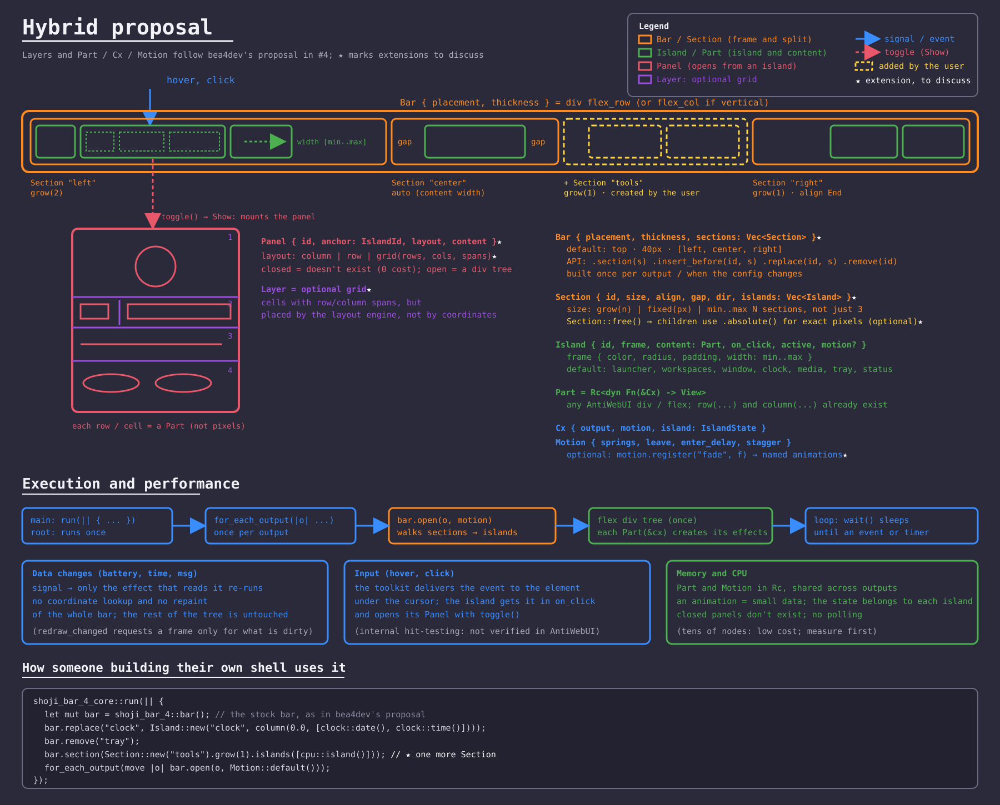

# Split Roadmap

The plan for the split agreed in [#4](https://github.com/bea4dev/shoji-bar-4/issues/4): the
components in a library (`shoji-bar-4-core`), the layout in the binary (`shoji-bar-4`), and custom
shells as ordinary crates that depend on them. Each step is one PR into `split`.

The layers and `Part` / `Cx` / `Motion` follow the proposal in #4. Items marked with ★ go beyond that
proposal and are open for discussion.

## Rules for every step

- One PR = one branch, started from an up to date `split`, with small atomic commits: each one builds
  and passes `cargo test --workspace`.
- Verify with preview and tests: a refactor must not change what is drawn, so
  `shoji-bar-4 preview bar` and `preview quick-settings` give the same image before and after.
- The PR text explains what moves, why, and how it is wired.

## Steps (PRs)

1. Refactor: core crate ([#12](https://github.com/bea4dev/shoji-bar-4/pull/12))
   - [x] make repo a cargo workspace
   - [x] public entry points for wayland layers
   - [x] move into shoji-bar-4-core
   - [x] call to run in the clean main
   - [x] fix docs describing workspace updating pointers to code
   - [x] only the binary is a default member (the core was included by mistake)

2. Refactor: stock layout as `bar()`
   - [ ] objects of the core: `Bar`, `Island`, `PanelDef`, placed as in the proposal in #4
         (`context.rs`, `bar/mod.rs`, `bar/island.rs`, `panels/`); every island and panel has a
         stable, unique `id`, to edit the layout with remove, add...
   - [ ] `layout.rs`: `row()`, `column()`, `spacer()`
   - [ ] move out layout of bar and panels out of core
   - [ ] `pub fn bar() -> Bar` in `shoji-bar-4/src/lib.rs`; `main.rs` calls `run`

3. Create `Part` and `Cx`
   - [ ] `Part = Rc<dyn Fn(&Cx) -> View>`
   - [ ] `Cx { output, island }`, `#[non_exhaustive]`: `motion` joins it in step 6
   - [ ] the content of every island becomes a `Part`

4. Refactor: move content out of the Island
   - [ ] Island as frame (shape, padding, hover, click, highlight, entrance); its content is a `Part`
   - [ ] `IslandState { hovered, active, index }` in `Cx`

5. Feat: bar builder (stable ids)
   - [ ] `.insert_before()`
   - [ ] `.insert_after()`
   - [ ] `.replace()`
   - [ ] `.remove()`
   - [ ] ★ `Vec<Section>` and `.section()`, to expand or reduce the number of sections instead of
         the fixed left / center / right (public on API to user)

6. Refactor: motion
   - [ ] collect static/constants animation into object Motion; `Motion::default()` keeps today's
         values; `motion` joins `Cx`; `pub fn motion() -> Motion` next to `bar()`
   - [ ] `enter_delay` and `stagger`: new behaviour, in a commit of their own
   - [ ] ★ named motions: `motion.register("fade", f)`

7. Refactor: panel
   - [ ] collect static/constants panels into object Panel (`PanelDef` and its builder); the
         contents of each panel become `Part`s
   - [ ] `Cx` outside the bar (`island: Option<IslandState>`) and a public `cascade(...)` helper
   - [ ] ★ `grid(rows, cols, spans)` as a layout for panels

8. Documentation
   - [ ] add examples: a custom shell, as a crate that depends on the core
   - [ ] update `docs/development.md` for the new layout of the code
   - [ ] add dotfiles as templates

## Open for discussion

- ★ Sections in any number, instead of the fixed `left` / `center` / `right`.
- ★ `Section::free()`, whose children are placed with `.absolute()` for exact pixels.
- ★ Named motions.
- ★ A grid layout for panels.

## Extra

1. Patch of AntiWebUI -> To OTHER REPOSITORY
   - [ ] zoom
   - [ ] execute command of notification (Open, Edit...)

2. Features specific to one desktop (for example Omarchy): they use the API once it exists, so they
   come after the split, in an optional crate.
